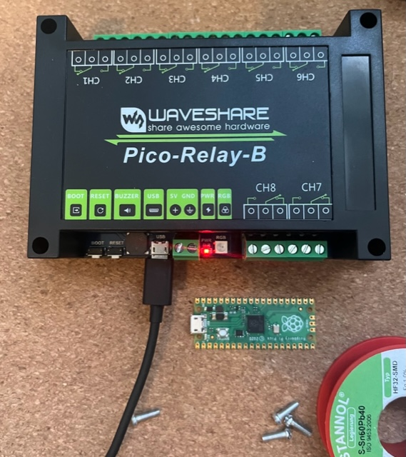

# Norn Firmware

[](https://github.com/nornforge/firmware/actions/workflows/go.yml)
[](https://github.com/nornforge/firmware/releases/latest)
[](LICENSE)

[TinyGo](https://tinygo.org) firmware for a Raspberry Pi Pico that switches the eight relays of the
[Waveshare Pico Relay B](https://www.waveshare.com/wiki/Pico-Relay-B) on request of a host connected over USB.



The project is split into two parts:

- this repository holds the firmware running on the Pico
- the [norn](https://github.com/nornforge/norn) repository holds the command line client and REST server
  that talk to it from the host

## Installing a release

1. Download `norn-firmware_pico_<version>.uf2` from the
   [latest release](https://github.com/nornforge/firmware/releases/latest).
   `checksums.txt` holds its SHA-256 checksum.
2. Hold the `BOOTSEL` button on the Pico while plugging it into the host. It shows up as a USB drive named `RPI-RP2`.
3. Copy the `.uf2` file onto that drive. The Pico reboots into the new firmware and the on-board LED turns on.

A Pico that already runs this firmware can be sent into the bootloader without pressing the button,
using `norn boot` from the [norn CLI](https://github.com/nornforge/norn).

## Usage

The firmware shows up on the host as a USB serial port (`/dev/ttyACM*` on Linux).
Use the [norn CLI](https://github.com/nornforge/norn) to switch the relays, read their state
or serve them over a REST API.

The relay state is not kept across a reset or power cycle.

### Channels

| Channel | Pico pin |
| ------- | -------- |
| 1       | GP21     |
| 2       | GP20     |
| 3       | GP19     |
| 4       | GP18     |
| 5       | GP17     |
| 6       | GP16     |
| 7       | GP15     |
| 8       | GP14     |

### Protocol

Host and firmware exchange framed JSON messages, implemented in
[`pkg/norn`](https://pkg.go.dev/github.com/nornforge/norn/pkg/norn). A frame looks like this:

```
E979#000000037#e2da8fab{"channel":1,"type":1,"status":false}ba9f13b7
```

| Part        | Content                                                    |
| ----------- | ---------------------------------------------------------- |
| `E979#`     | start marker                                               |
| `000000037` | length of the JSON payload in bytes, nine decimal digits   |
| `#`         | separator                                                  |
| `e2da8fab`  | CRC-32C of the length field, eight hex digits              |
| `{…}`       | JSON payload                                               |
| `ba9f13b7`  | CRC-32C of the JSON payload, eight hex digits              |

The `type` of a command selects what the firmware does:

| Type | Command      | Effect                                                 |
| ---- | ------------ | ------------------------------------------------------ |
| 1    | get          | report the state of `channel`                          |
| 2    | set          | switch `channel` to `status` and report the new state  |
| 3    | version      | report the firmware version in `message`               |
| 4    | bootloader   | reboot into the USB bootloader                         |
| 5    | max channels | report the number of channels in `max_channel`         |

Every command except bootloader is answered with a frame of the same layout carrying
`isOk`, `message`, `channel`, `max_channel` and `status`. On an error `isOk` is `false`
and `message` holds the reason.

## Development

The repository comes with a [dev container](.devcontainer/devcontainer.json) that provides Go and TinyGo.
The code imports TinyGo's `machine` package, so build and test it with `tinygo` rather than plain `go`.

```sh
tinygo build -size short -o firmware.uf2 -target=pico ./firmware   # build
tinygo test -v ./...                                                # test
```

A build without further options reports the version `v0.0.0`. To set it, pass

```sh
tinygo build -o firmware.uf2 -target=pico -ldflags="-X 'main.Version=v1.2.3'" ./firmware
```

Flashing from inside the dev container is not supported: copy the resulting `firmware.uf2` onto the Pico
from the host as described in [Installing a release](#installing-a-release).

On a Linux host the Pico's serial port is passed into the dev container as `/dev/ttyACM*`.
The device node keeps the group it has on the host, so access from inside the container may need `sudo`.

### Releasing

Pushing a tag builds the firmware with that tag as its version and publishes it as a GitHub release.
The changelog is generated from the commit messages, which therefore follow
[Conventional Commits](https://www.conventionalcommits.org).

## License

This software is licensed under the [Apache License Version 2.0](LICENSE)
