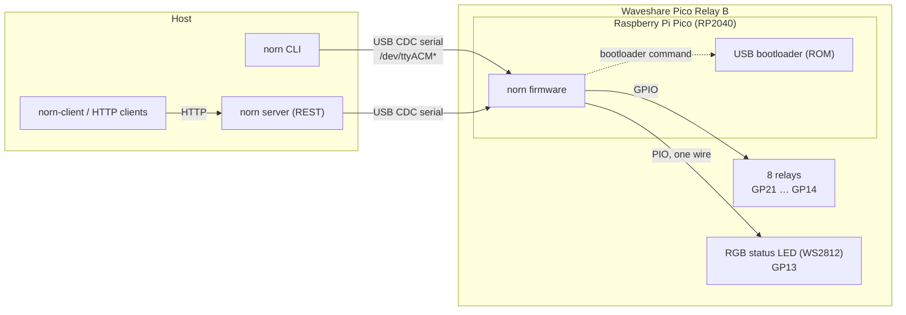
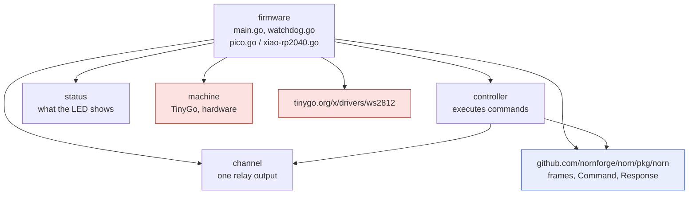
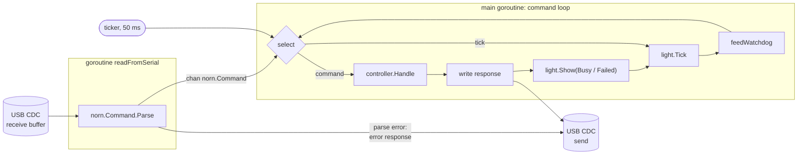
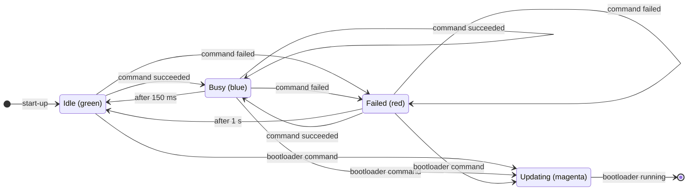
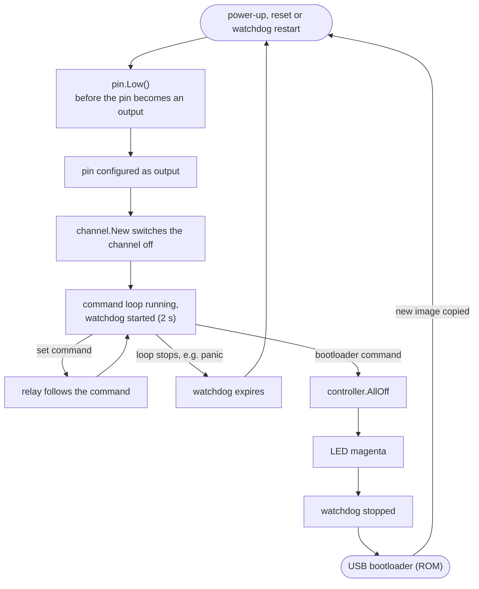
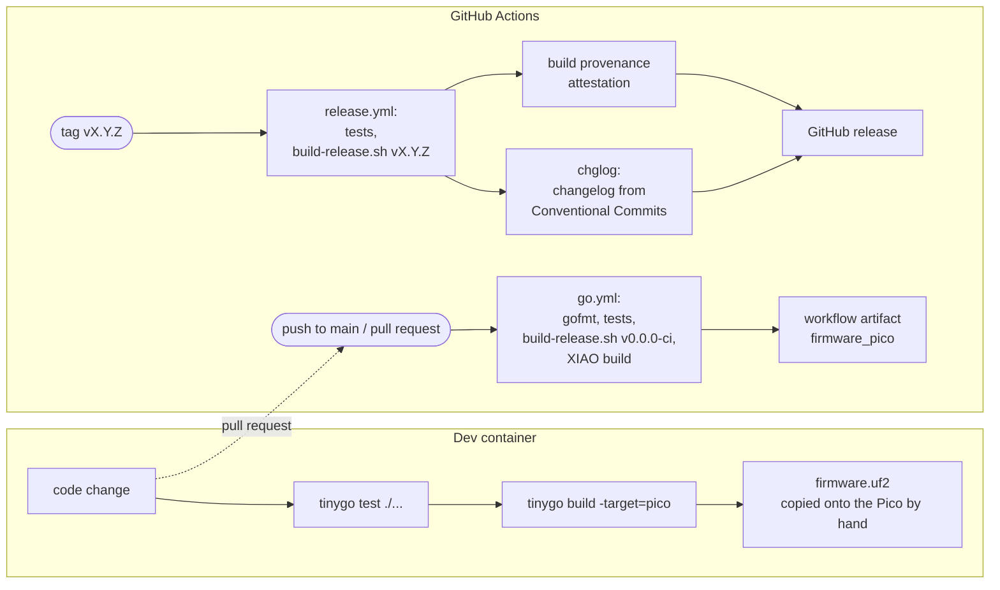

# Architecture

This document describes how the firmware is built up, how a command travels from the host to a relay,
and how the image gets from a commit to a release. For installing and using the firmware see the
[README](../README.md).

## Overview

The firmware runs on a Raspberry Pi Pico (RP2040) plugged onto a Waveshare Pico Relay B. It shows up on the
host as a USB serial port. Programs on the host use the [norn](https://github.com/nornforge/norn) package to
send commands; the firmware switches the relays and answers each command.



Only one program should use the serial port at a time. Several clients share the board through the REST server
of the norn CLI.

## Packages

The code that decides what happens is kept free of TinyGo's `machine` package, so its tests run on the
development machine without hardware (also with plain `go test`). Only `firmware/` touches the hardware.



| Package       | Responsibility                                                                                     |
| ------------- | -------------------------------------------------------------------------------------------------- |
| `firmware/`   | Wires everything up: pins, serial line, LED driver, watchdog, bootloader. The only `machine` user. |
| `controller/` | Executes a `norn.Command` on the channels and builds the `norn.Response`.                          |
| `channel/`    | A relay output that remembers the state it was switched to. Drives a `channel.Pin`.                |
| `status/`     | Which color the LED shows for which state, how long, and at which brightness.                      |

Interfaces keep the hardware out of these packages:

| Interface        | Needed by           | Satisfied on the board by | Satisfied in tests by |
| ---------------- | ------------------- | ------------------------- | --------------------- |
| `channel.Pin`    | `channel.Channel`   | `machine.Pin`             | a fake pin            |
| `status.Writer`  | `status.Light`      | `ws2812.Device`           | a fake LED            |
| `func()`         | `controller` (bootloader) | `enterBootloader` in `firmware/` | a counter     |
| `func(uint8)`    | `controller` (brightness) | `status.Light.SetBrightness`    | a recorder    |

### Board variants

The pin mapping is chosen with the TinyGo target. Both files define `led`, `rgbPin` and `Channels`.

| Target        | File                      | Channels | Note                                                  |
| ------------- | ------------------------- | -------- | ----------------------------------------------------- |
| `pico`        | `firmware/pico.go`        | 8        | Waveshare Pico Relay B; the released image            |
| `xiao-rp2040` | `firmware/xiao-rp2040.go` | 4        | not pin compatible with the Relay B; built in CI only |

## Runtime

Two goroutines run after start-up. One reads frames from the serial line, the other executes them. The
command loop also wakes up every 50 ms on its own, so the LED can return to green and the watchdog is fed
while no command arrives.



Running the commands in a single goroutine means the controller, the channels and the LED need no locking.

### A command from the host to the relay

```mermaid
sequenceDiagram
    autonumber
    participant Host as norn CLI
    participant Reader as readFromSerial
    participant Loop as command loop
    participant Ctrl as controller
    participant Ch as channel
    participant LED as status.Light

    Host->>Reader: frame {"type":2,"channel":3,"status":true}
    Reader->>Reader: check marker, length, CRC-32C
    Reader->>Loop: norn.Command via channel
    Loop->>Ctrl: Handle(command)
    Ctrl->>Ch: Set(true)
    Ch->>Ch: pin.Set(true), remember state
    Ctrl-->>Loop: Response{isOk, channel 3, status true}
    Loop-->>Host: response frame
    Loop->>LED: Show(Busy), blue for 150 ms
    Note over Loop,LED: later ticks return the LED to Idle (green)
```

If the frame cannot be parsed, `readFromSerial` answers with an error frame itself and the command never
reaches the loop. If the controller rejects the command (unknown type, channel out of range, brightness above
255), the response has `isOk: false` and the LED turns red for one second.

The frame layout and the command types are described in the README under
[Protocol](../README.md#protocol).

### Status LED



The hold times are checked by `Light.Tick`, which the command loop calls after every command and every 50 ms.
The brightness (default 16 of 255) scales all colors and does not change the state.

## Relay safety

Off is the state the firmware falls back to. Several places make sure a relay is never switched on by
accident:



- **Start-up:** the level of each relay pin is set low before the pin is switched to an output, so the relays
  do not see a pulse. `channel.New` then records the state as off.
- **Watchdog:** it restarts the firmware if the command loop has not run for two seconds. After the restart all
  relays are off.
- **Bootloader:** all relays are switched off before the bootloader is entered, because nothing controls them
  while it runs. The watchdog is stopped first, since the bootloader does not feed it.
- **Host gone:** if the host program exits or USB is unplugged while the board stays powered, the relays keep
  their state. The firmware does not watch for the host: a CLI call ends right after its command, and the
  relays are expected to stay as it left them.

The resulting behaviour is summarised in the README under [Relay states](../README.md#relay-states).

## Build and release



`scripts/build-release.sh <version>` produces the same files locally and in both workflows:

| File                                   | Content                                                             |
| -------------------------------------- | ------------------------------------------------------------------- |
| `norn-firmware_pico_<version>.uf2`     | the firmware image, version injected with `-ldflags -X main.Version` |
| `norn-firmware_pico_<version>.cdx.json`| CycloneDX 1.5 SBOM: linked Go modules, TinyGo, Go standard library   |
| `checksums.txt`                        | SHA-256 of image and SBOM                                           |

Only tags of the form `vX.Y.Z` start a release. The versions of Go, TinyGo and the norn CLI are pinned in the
dev container and in the workflows and are kept in sync by hand; the actions are pinned to commit hashes and
updated by Dependabot.
